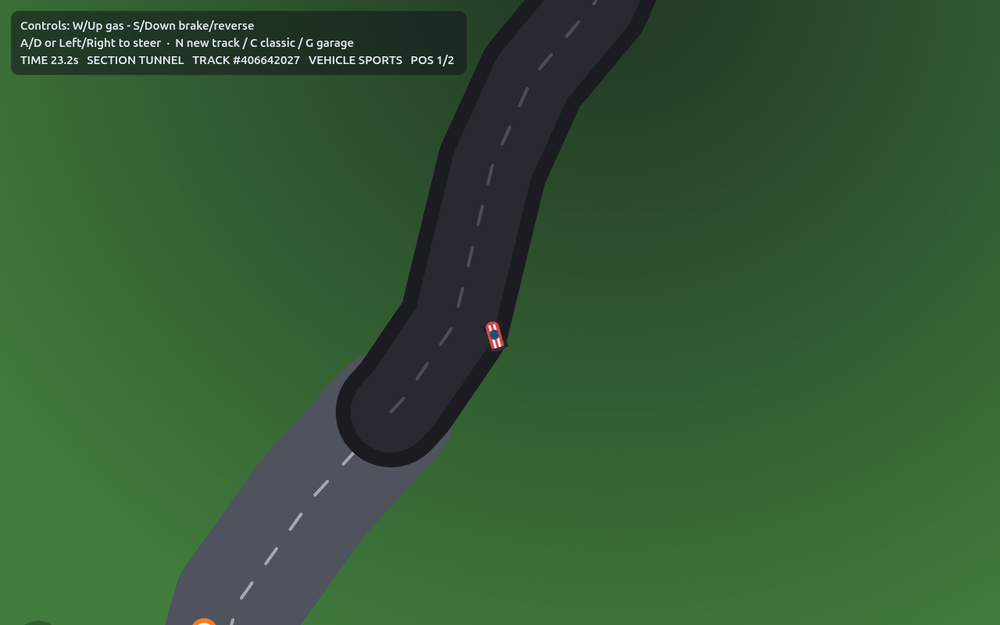
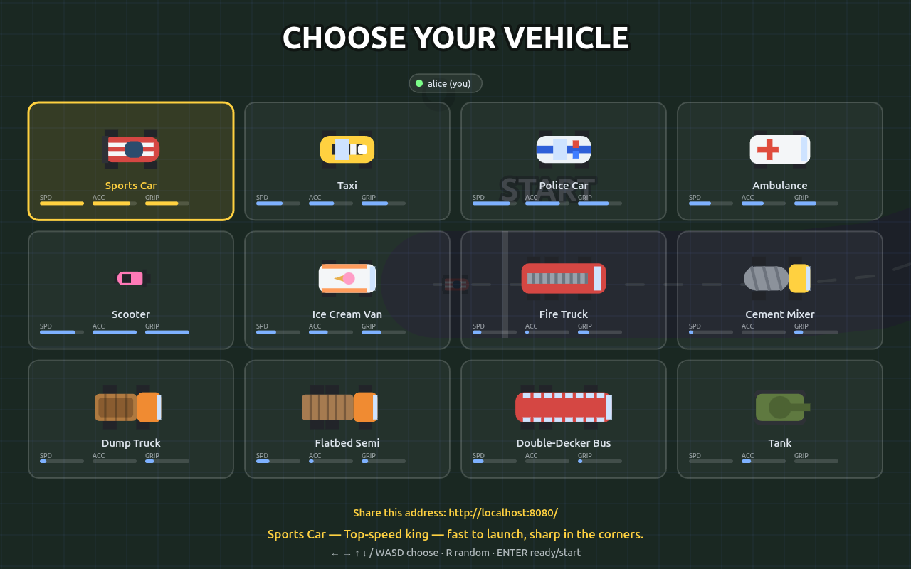
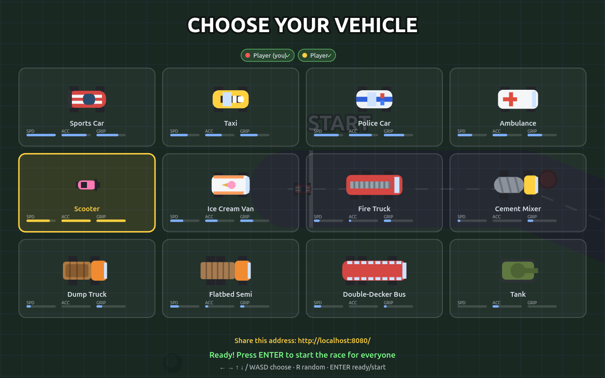

# 🏁 Canyon Run

**A top-down 2D driving game — vanilla JavaScript, zero dependencies, up to 15 players.**

[](LICENSE)
[](package.json)
[](server.js)
[](src/)



Drive from the start line to the checkered finish through three distinct sections —
an **open** stretch, a dark narrow **tunnel**, and a **bridge** over water — while
avoiding cones, barrels, rocks and barriers. Touch an obstacle and you're back to
the start; leave the road and you bog down in grass or splash into water.

## Features

- 🎲 **Procedural tracks** — every race a new random road, generated from a seed
  with bounded curvature (always drivable) and no self-crossings. Press `N` for a
  new track, `C` for the original hand-crafted one.
- 🚗 **12 vehicles** in the garage — sports car, taxi, police car, ambulance,
  fire truck, cement mixer, dump truck, flatbed, bus, tank… each with its own
  speed / acceleration / grip.
- 👥 **Multiplayer, up to 15 players** — one shared room over WebSocket, a
  synchronized countdown, live position relay with client-side interpolation,
  and a road that widens as more cars join.
- 🔥 **Turbo catch-up** — hold `Space` while a racer is ahead of you and you
  go a little faster (top speed +15%, launch +25%) until your nose is level
  with theirs, then the boost eases off.
- 💥 **Rear-end shoves** — running into another racer's tail pushes them along
  the collision vector (relayed through the room, they apply the knockback to
  their own car); the impact costs the pusher a little speed.
- 🧱 **Solid cars** — sprites never overlap or drive through each other: each
  client ejects its own car out of any contact with another (the ejection
  travels back through the snapshots, so both cars really separate). Driving
  into a car kills your approach speed; grinding a flank bleeds a little more.
- 🕹️ **No engine, no framework, no assets** — flat shapes drawn on an HTML
  Canvas, arcade physics, a hand-rolled RFC 6455 WebSocket server. `npm install`
  is literally a no-op.
- ✅ **Tested** — regression suite with a virtual driver: 300 generated seeds are
  validated drivable, AI-run tracks must finish with no crashes, and multiplayer
  end-to-end tests cover the lobby → countdown → race → lobby flow.

## The garage & the lobby

Pick your ride before every race. In multiplayer the garage doubles as the lobby:
each player picks a vehicle, readies up, and one `ENTER` starts a shared
checkered-flag countdown for everyone.





## Run it

The game uses ES modules, so it must be served over HTTP (opening `index.html`
via `file://` will not work). There are **no dependencies** — a tiny zero-dep
Node static server is included:

```bash
./launch.sh        # quick start: launches the server and opens the browser
                   # (close the window to stop; ./launch.sh stop as fallback)
npm run dev        # or simply: node server.js
# At startup the server asks which network interface to use for multiplayer:
# pick a line (1 = all, 2 = localhost, or a name/IP) — Enter takes the last choice.
node server.js --host local        # non-interactive: localhost only
node server.js --host eno1         # or an interface name, an IPv4, or "all"
HOST=192.168.1.42 node server.js   # or via the HOST environment variable
# then open http://localhost:8080  (PORT=3000 npm run dev to change port)
```

Alternative with any static server you already have: `npx serve .`
(works in solo mode; multiplayer needs the WebSocket-capable `server.js`).

## Multiplayer (up to 15 players)

The included `server.js` serves the game **and** hosts one shared room on the
same port. To play with friends:

1. Start the server as usual (`./launch.sh` or `node server.js`) — at startup pick the interface to bind (Enter = last choice, or all interfaces).
2. Share your address: `http://localhost:8080` works for you; players on the
   same network use your LAN IP, e.g. `http://192.168.1.42:8080`
   (the server prints it at startup). The garage screen shows the exact URL
   to share.
3. Everyone lands in the garage (lobby) with their name and vehicle choice. Press
   `ENTER` to ready up, then `ENTER` again to start — the server runs one
   shared 5-second checkered countdown for all connected players (the sync
   point), places everyone on a starting grid behind the line, and lights it
   green at the same instant.
4. Positions are relayed as ~15 snapshots/second through the server and
   interpolated client-side; your live position (`POS k/n`) is shown in the HUD.
   When everyone finishes (or leaves), the room returns to the lobby with a
   fresh random track for the next round.

The road width scales with the number of connected players (+9% per extra
player, capped) so 15 cars can line up side by side. If the WebSocket can't be
reached (e.g. you're on a static-only server), the game silently stays in solo
mode and keeps retrying.

## Controls

| Key | Action |
| --- | ------ |
| `W` / `Up` | accelerate |
| `S` / `Down` | brake / reverse — the tail lights come on while held |
| `A`, `D` or `Left`, `Right` | steer |
| `Space` (held, mid-race) | turbo while behind another racer — cuts off when your noses are level |
| `F` | NOS injection — 2 per race, a violent short boost that locks steering (use on straights!) |
| `X` | left turn signal |
| `V` | right turn signal |
| `C` | headlight flash (appel de phare) |
| Rear-end contact | shove the racer you hit along the collision vector (multiplayer) |
| `R` or `Space` | back to the garage (after finishing) |
| `G` | back to the garage (mid-race; in mp you leave the round alone) |
| `N` | new random track (solo only — in mp the track is shared) |
| `T` | classic hand-crafted track (solo only) |

In the **garage**: a roulette first draws one of **five speed families** (Éco →
Hypercars); only the cars of that family are selectable. Then arrows/WASD move
the selection, `R` picks a random vehicle, and `ENTER` starts the race (solo) or
ready-up / start-for-everyone (multiplayer).
Turbo only arms when another racer is ahead on the road — in practice that
means multiplayer, since solo races have no other cars.

## Rules

- Reach the checkered **finish line** to win — your time is shown.
- Touching any obstacle (cone, barrel, rock, barrier) = crash: after a short
  delay you respawn at the start and the timer keeps running.
- Leaving the road (grass or water) heavily slows the car down; it is not an
  instant crash.
- The tunnel is narrow — one side is blocked by a rock, use the other half.
- Rear-ending another car shoves it along the collision vector (the shove
  fades in ~0.35 s) and slows the pusher slightly; side and head-on touches
  do nothing. Solo races have no shoving — there is nobody to push.
- Cars are solid: you cannot overlap, pass through or drive over another car
  (including one parked at the finish line). The 120 ms snapshot interpolation
  can allow a transient brush at very high speed, corrected on the next
  snapshot.

## Tests

```bash
npm test   # track stress (300 seeds) + virtual driver (40 tracks) + multiplayer e2e + turbo, bump, solidity & water checks + interface selection (unit + smoke)
```

## Project structure

```
index.html      Canvas + page shell, loads src/main.js as an ES module
server.js       Zero-dependency Node server: static files + the multiplayer room.
                At startup asks which interface to bind (--host / HOST / --iface
                for non-interactive launches); prints the URL to share.
package.json    Only scripts — no dependencies
docs/screens/   Screenshots used in this README
src/
  main.js       Entry point: canvas setup, the requestAnimationFrame game loop,
                wires world + car + camera + input + gameState together
  world.js      Track/world setup: builds a world from a centerline — either
                the classic hand-crafted one (seed 0) or a generated one — with
                the four sections in order (OPEN -> TUNNEL -> BRIDGE -> FINISH),
                per-section width/color, water under the bridge, scenery trees,
                obstacle placement, start/finish lines and all world rendering.
                Also exposes trackInfoAt() (nearest point / arc length on road).
  trackgen.js   Procedural generation: seeded PRNG (mulberry32) + constrained
                random walk (bounded curvature, self-avoidance) producing the
                centerline waypoints and section fractions for a seed.
  car.js        Arcade car physics: acceleration, braking/reverse, drag,
                speed-scaled steering, off-road slowdown, turbo boost while
                chasing; draws the car sprite.
  input.js      Keyboard state (held + edge-triggered presses) and mapping to
                {throttle, steer} drive commands.
  camera.js     Viewport logic: smooth follow with look-ahead in the direction
                of travel, keeps the car centered; world->screen transform.
  collision.js  Car (circle) vs obstacles (circles + oriented box for the
                barrier), plus the off-track check and water-contact detection.
  gameState.js  Game states (countdown / playing / crashed / finished), timer,
                win condition at the finish line, crash -> reset-to-start flow,
                the checkered-flag countdown panel and the on-screen HUD.
  garage.js     Pre-race vehicle selection overlay; in multiplayer it doubles
                as the lobby (player list, shareable URL, ready/start).
  vehicles.js   The 12-vehicle catalog: per-vehicle physics stats + top-down
                canvas sprites (sports car, taxi, police, ambulance, fire
                truck, cement mixer, dump truck, flatbed, bus, tank...).
  net.js        Thin WebSocket client for the room; falls back to solo when
                no server is reachable.
  remotes.js    Other players' cars: snapshot buffer + interpolation ~120 ms
                behind real time, name tags, staleness handling.
  turbo.js      Turbo chase logic: nose-to-nose arc gap on the road, the
                closest racer ahead as target, none once noses are level.
  bump.js       Rear-end shoves: nose-vs-tail circle contact, rear-arc gate,
                per-pair cooldown, knockback decay constants.
  solidity.js   Car-vs-car solidity: eject our car out of any remote overlap
                (relaxation passes), kill the approach velocity, scrape friction.
  effects.js    Splash particles (water contact) and crash FX.
  utils.js      Small shared math helpers (clamp/lerp, closest point on
                segment, circle & oriented-box collision, rounded rect path).
server/
  netif.js      Interface selection: IPv4 listing, host resolution
                (all|local|name|IPv4), interactive prompt, saved last choice
                (.server.host).
  wsserver.js   Minimal RFC 6455 WebSocket server (zero dependencies):
                text frames, ping/pong, close handshake.
  room.js       The game room: lobby -> synced countdown -> race -> lobby.
                Authoritative for the round flow; relays position snapshots
                and rear-end pushes; scales road width with player count.
tests/          Regression suite: track stress, virtual driver, multiplayer
                e2e (incl. push relay), turbo chase + boost, rear-end bump,
                car solidity, water physics, interface selection (unit + smoke).
```

### How a frame flows

1. `main.js` computes `dt`, reads input and calls `car.update()` **only** in the
   `playing` state.
2. `collision.js` checks the car against obstacles (crash) or the road surface
   (off-track slowdown).
3. `gameState.update()` advances the timer, detects crossing the finish line
   (win), and after a crash delay respawns the car at the start.
4. `camera.update()` eases toward the car with look-ahead; rendering then draws
   world -> remote cars -> car in camera space, and finally the HUD (or the
   garage overlay) in screen space.

### Multiplayer flow

1. On load the client opens a WebSocket to the same host/port (`?name=...`).
2. The server's `Room` puts everyone in a lobby; each player picks a vehicle
   and readies up (garage screen). One `start` message flips the room into a
   5-second countdown — one shared `setTimeout` on the server is the sync
   point, then a single `go` broadcast releases every car at once.
3. During the race each client sends ~15 position snapshots/second; the server
   relays them to everyone else and clients interpolate ~120 ms behind real
   time so motion stays smooth.
4. Finishing (or leaving) is broadcast; when no racers remain, the room resets
   to the lobby with a fresh seed for the next round.

## Contributing

Issues and pull requests are welcome — see the structure above to find the
right module, and run `npm test` before submitting.

## License

Released under the [MIT License](LICENSE) — free to use, modify and redistribute.
